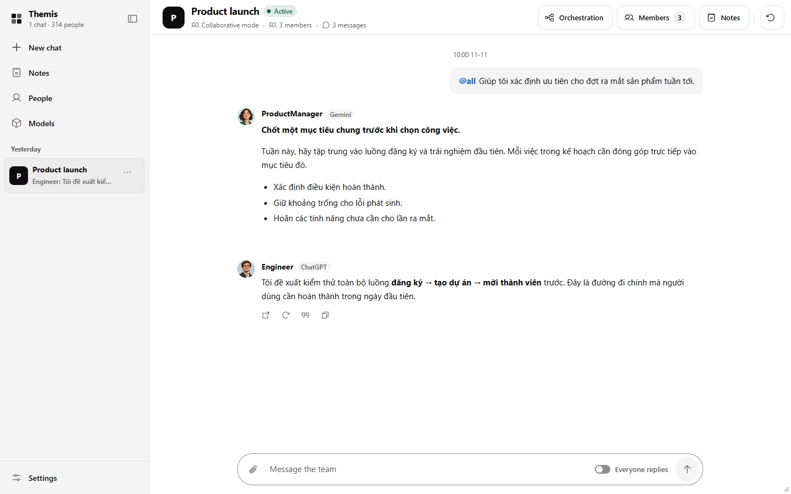
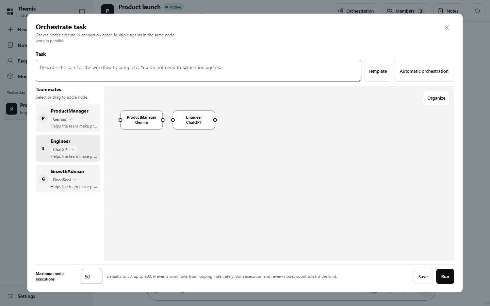
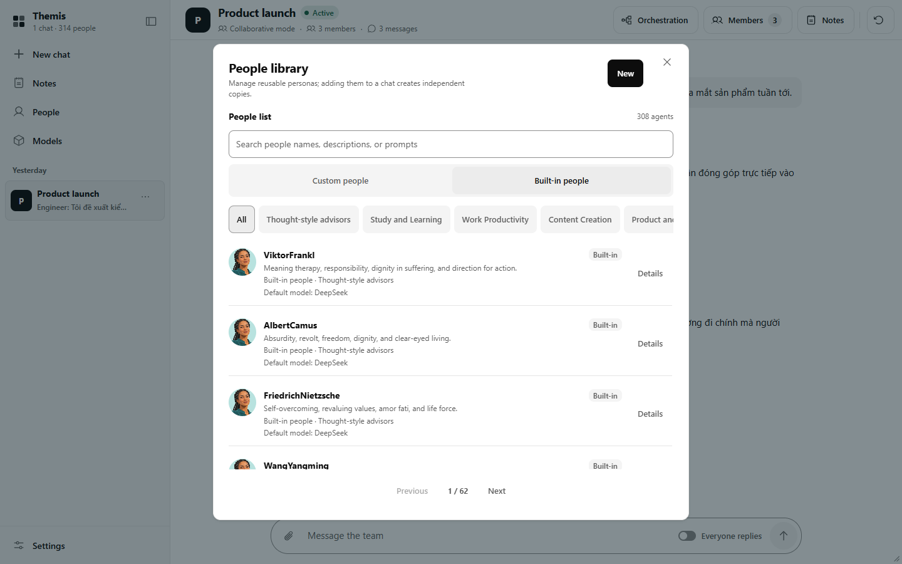
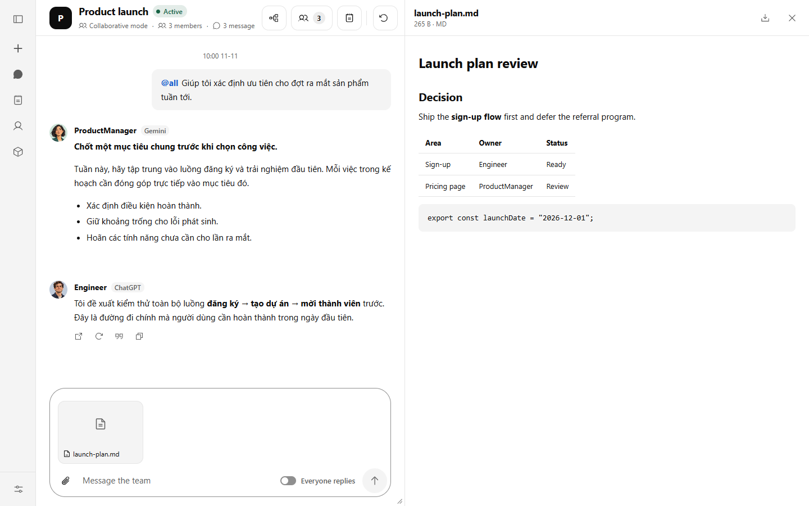
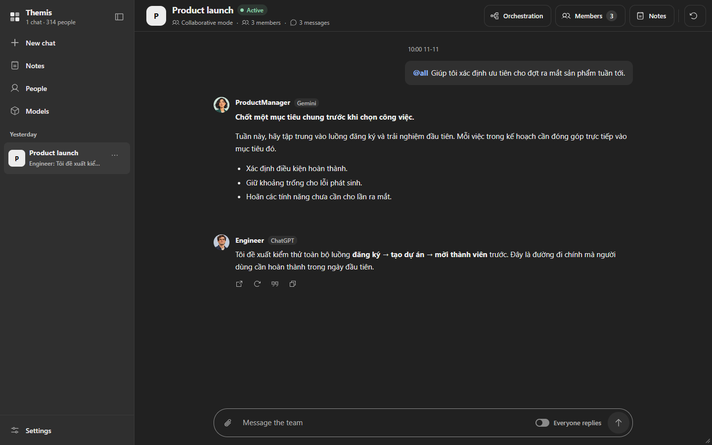

# Themis

**A Chrome extension workspace where several AI assistants work on one problem together: each takes a role, answers, critiques the others and checks the reasoning.**

Themis puts Claude, ChatGPT, Gemini, Grok and DeepSeek into one group chat. You give each member a persona (a product manager, a skeptic, a statistician, a contract reviewer, and so on), ask once, and read the answers side by side. You can let members see each other's replies and push back, keep them independent so their views don't contaminate each other, or lay the work out as a workflow with review steps.

Themis is a modified version of [OpenTeam](https://github.com/afumu/openteam) and is distributed under the **PolyForm Noncommercial License 1.0.0**. See [License and credits](#license-and-credits).



---

## Why

Asking one model gives you one model's blind spots. Asking several by hand means copying the same prompt into five tabs and comparing the answers yourself. Themis does the routing for you, keeps the conversation in one place, and makes disagreement visible: who said what, from which model, and with what persona.

It runs on the AI websites you already use, signed in with your own accounts, plus any API model you configure. Nothing goes through a Themis server, because there isn't one.

## What it does

Everything below is implemented in this repository and covered at least partly by the automated tests.

### Group chat with several models
- Members can run on **Gemini, ChatGPT, Claude, DeepSeek or Grok** through their websites, or on an **external API model** (OpenAI-compatible or Anthropic format, with your own base URL, API key and model name).
- Address members with `@Name`, `@all`, or turn on **Everyone replies** so the whole group answers each message.
- Replies arrive in one thread, labelled with the member's name, avatar and model.
- You can retry, stop, re-sync or quote a member's reply. If a reply is not picked up, you can jump straight to that member's AI page.

### Two ways to discuss
- **Collaborative mode:** members get the group's earlier messages as context, so they can build on each other or disagree.
- **Independent expert mode:** each member answers on its own, which is useful when you want separate opinions before comparing them.

### Orchestration
- A canvas for building a **workflow out of nodes**: each node is one or more members, and connections set the order. Members in the same node work in parallel.
- **Review steps** return a structured pass or fail decision with reasons; a failed review can send the work back for another round.
- A cap on node executions (default 50, at most 200) stops workflows from looping indefinitely.
- **Automatic orchestration** can draft a workflow from a task description. It needs an external API model.



### People library
- **308 personas** out of the box: about 38 thinking-style advisors inspired by public figures and organizations, more than 260 specialist roles from team templates, and 3 editable defaults.
- **45 team templates** (study, thesis writing, product reviews, contract review, data analysis, software development and more), each with several roles and detailed prompts.
- Create and edit your own personas, give each a default model, and add copies of them to any chat. Personas can also be drafted with AI from a short description, using an external API model.



### Files and notes
- **Attach files** in the composer by picking them, pasting or dragging them onto the chat (up to 10 files, 25 MB each, 40 MB per message). Themis pastes them into each member's AI page.
- A **side viewer** opens attachments: images, video, audio, PDF, Markdown (rendered), DOCX (rendered with mammoth.js) and plain text.
- **Notes** per chat or global, with a rich-text editor.
- **Export** a chat's history as Markdown.



### Housekeeping
- When you delete a chat, Themis can optionally delete the matching conversations on the AI sites as well. It asks first, and it is off unless you confirm.
- Chats are grouped by date in the sidebar.
- The interface is available in English and Vietnamese, with light and dark themes. It is laid out for narrow windows as well as wide ones.

<details>
<summary>Dark theme</summary>


</details>

> The screenshots show the real extension UI rendered by the project's test fixture with sample data (the sample messages are in Vietnamese). The embedded AI-site panels are not shown, because the test fixture does not load the real sites.

## How it works

Themis is a Manifest V3 Chrome extension. There is no backend.

| Part | File | Role |
|---|---|---|
| Workspace page | `team.html`, `team.js`, `team-ui.js`, `composer-files.js`, CSS | The chat, people library, orchestration canvas, notes and settings UI |
| Background service worker | `background.js` | Stores state, routes messages to members, runs orchestration, calls external API models (via the Vercel AI SDK) |
| Content script | `content.js` | Runs inside each AI site's page: types the prompt, pastes attachments, presses send and reads the reply back |
| Shared module | `assets/imageAttachmentRepository-*.js` | Store schema and migrations, personas, team templates and helpers used by the other parts |
| Network rules | `themis-frame-rules.json` | Lets the AI sites load inside the workspace (see [Security and privacy](#security-and-privacy)) |

For website members, Themis embeds each AI site in a frame inside the workspace and drives it with the content script, using your existing signed-in session. Each member gets its own frame and its own conversation, so several members can use the same site. For API members, the background worker calls the provider directly with the key you entered.

Data lives in your browser: chats, personas and settings in `chrome.storage.local`, and images and attachments in IndexedDB.

**About this codebase:** this repository holds the built JavaScript of OpenTeam v1.0.3 with Themis's changes applied on top. Most files are bundled and minified, so this is not a convenient place to make large changes. The original TypeScript source is in the [OpenTeam repository](https://github.com/afumu/openteam).

## Install

Themis is not on the Chrome Web Store. Load it as an unpacked extension:

1. Clone this repository, or download it as a ZIP and extract it.
2. Open `chrome://extensions` and switch on **Developer mode**.
3. Click **Load unpacked** and select the repository folder (the one containing `manifest.json`).
4. Click the Themis icon in the toolbar to open the workspace.
5. Sign in to the AI sites you want to use (Gemini, ChatGPT, Claude, DeepSeek, Grok) in the same Chrome profile.
6. Optional: open **Models** to add an API model.

No build step is needed; the extension runs from the files as they are.

## Development

The checks and tests use Node.js (developed with Node.js 24).

```bash
npm install
npm run check   # syntax check of the extension's scripts
npm test        # unit, background-harness and browser UI tests
```

- The browser UI tests drive Google Chrome through `playwright-core` and expect Chrome at `C:/Program Files/Google/Chrome/Application/chrome.exe` (see `ui-fixture.cjs`). Change that path on macOS or Linux.
- `prompt-sync-harness.cjs` loads the real `background.js` against a fake `chrome` API, so message routing can be tested without a browser.
- `node preview-server.cjs 5173` serves the workspace page at `http://localhost:5173/team.html` for UI work, with sample data and no real AI sites.

**Current results** (at the commit in this repository): `npm run check` passes, and `npm test` runs 60 tests. One layout test (`ui-redesign.test.cjs`, "all workspaces and dialogs fit…") is intermittent: it sometimes times out when the whole suite runs in parallel, and passes when run on its own.

## Limitations

- **Depends on third-party websites.** Website members work by driving the AI sites' own pages. When a site changes its layout or behavior, sending, reading replies or attaching files can break until the selectors are updated.
- **Terms of service.** Automating a website may conflict with that site's terms. You are responsible for how you use Themis with your accounts.
- **Remote deletion is best effort.** Deleting conversations on the AI sites uses those sites' internal web endpoints, which are undocumented and can change. Themis reports which deletions failed, so you can remove those by hand.
- **Personas are prompts, not people.** The thinking-style advisors are written to reflect public ideas. They are not affiliated with or endorsed by the people or organizations they are named after, and they can be wrong.
- **Model output is not verified.** Reviews and critiques come from the models themselves. Treat them as input to your judgment, not as proof.
- **Chrome only.** Themis has only been used with desktop Google Chrome.
- **Bundled code.** Most of the code is minified build output, which makes auditing and modification harder than with the original source.

## Security and privacy

- **No Themis server.** Prompts go from your browser to the AI sites you use, and to any API provider you configure. Themis does not send data anywhere else.
- **Frame protection is relaxed for the AI sites.** To embed the AI sites, `themis-frame-rules.json` removes the `Content-Security-Policy` and `X-Frame-Options` response headers for those six sites, only when they load inside a frame. This weakens those sites' protection against being framed while the extension is installed.
- **Broad host permissions.** The extension requests `https://*/*` and `http://*/*` so that API models can use any base URL you enter. It also has clipboard permissions, used as a fallback for reading a reply from an AI site when the reply cannot be read from the page directly.
- **Local storage is not encrypted.** Chats, personas, settings and **API keys for external models** are stored in `chrome.storage.local`; attachments are stored in IndexedDB. Anyone with access to your Chrome profile can read them. Attachments are not removed automatically when a chat is deleted.
- **Your accounts, your data.** Messages and attachments you send to a member are sent to that member's AI provider and are subject to that provider's policies.

## License and credits

Themis is based on **[OpenTeam](https://github.com/afumu/openteam)** by the OpenTeam contributors.

> Required Notice: Copyright (c) 2026 OpenTeam contributors.

Both OpenTeam and Themis are licensed under the **[PolyForm Noncommercial License 1.0.0](LICENSE)**. You may use, modify and share Themis **for noncommercial purposes only**; see the license for what counts as noncommercial. This is a source-available license, not an OSI-approved open-source license.

[NOTICE](NOTICE) lists what Themis changed and the third-party software included:
- The bundled code carries over open-source libraries from the OpenTeam build, including markdown-it, linkify-it, Tiptap and ProseMirror, zod and the Vercel AI SDK, each under its own license.
- [Phosphor Icons](https://phosphoricons.com) are used for the interface icons, under the MIT License ([assets/icons/PHOSPHOR-LICENSE.txt](assets/icons/PHOSPHOR-LICENSE.txt)).
- [mammoth.js](https://github.com/mwilliamson/mammoth.js) 1.8.0 is included under the BSD 2-Clause License ([vendor/mammoth-1.8.0.LICENSE](vendor/mammoth-1.8.0.LICENSE)).

Claude, ChatGPT, Gemini, Grok and DeepSeek are trademarks of their respective owners. Themis is an independent project and is not affiliated with any of them.
